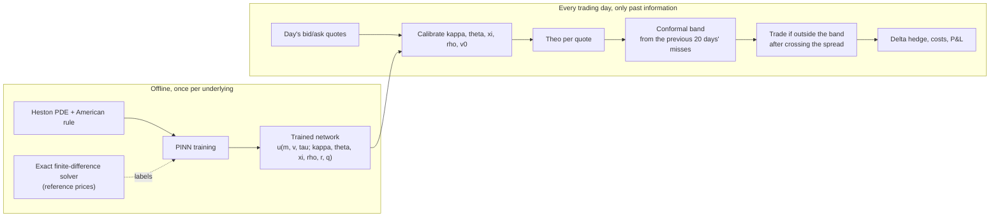
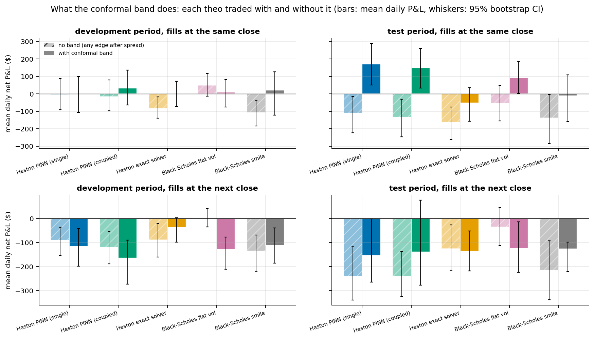

# ivuq: a Heston physics-informed theo with a conformal band, tested on real option quotes

Prices American puts under the Heston stochastic-volatility model with a neural network that obeys the pricing PDE,
fits it to each day's market quotes to get a *theo* (model fair value), puts a past-only conformal band around that
theo, and trades only when the market quote falls outside the band. Everything is walk-forward, delta hedged and
charged for costs, and tested against simple benchmarks and random trading.

**Research paper (draft):** [`ivuq_research_paper_draft.pdf`](ivuq_research_paper_draft.pdf)

> **Status and honest summary.** Research code, results reported as found. The pricing network, the calibration and
> the conformal band work as designed. Trading outside the band made money in the test months when filled at the
> same close the signal was computed from, and lost money when filled at the next close. A plain Black-Scholes theo
> with the same band did about as well. So there is **no demonstrated tradable edge** on end-of-day data. This is a
> reported null result on the trading question, not a hidden one.

## At a glance

| | |
|---|---|
| **Task** | Price American puts under Heston, turn the price into a trade signal with an error band |
| **Model** | Parameter-conditioned physics-informed network (single and coupled), checked against an exact finite-difference solver |
| **Data** | End-of-day AAPL, NVDA, SPY put quotes, 16 Oct 2025 to 21 Oct 2026 (251 dates, 55,950 quotes) |
| **Uncertainty** | Rolling past-only Mondrian conformal band, level 0.10, 20-day window |
| **Trading** | Take the quote outside the band, delta hedge, 3-day hold, costs charged |
| **Tests** | Development / test split, frozen settings, random control, benchmarks, live forward test |
| **Headline** | Network within about 5 cents per \$100 strike of the solver; band covers about 90% on average; profit at the same close, none at the next close |

## Contents

1. [The problem](#1-the-problem)
2. [Approach in one picture](#2-approach-in-one-picture)
3. [Methodology](#3-methodology)
   1. [The model and the pricing equation](#31-the-model-and-the-pricing-equation)
   2. [The American rule](#32-the-american-rule)
   3. [Exact finite-difference solver (reference)](#33-exact-finite-difference-solver-reference)
   4. [The physics-informed network](#34-the-physics-informed-network)
   5. [The coupled network](#35-the-coupled-network)
   6. [Market data](#36-market-data)
   7. [Daily calibration](#37-daily-calibration)
   8. [Comparison theos](#38-comparison-theos)
   9. [The conformal band](#39-the-conformal-band)
   10. [Trading rule, fills, hedge and costs](#310-trading-rule-fills-hedge-and-costs)
   11. [Evaluation protocol](#311-evaluation-protocol)
4. [Results](#4-results)
5. [What went wrong and what we changed](#5-what-went-wrong-and-what-we-changed)
6. [Limitations](#6-limitations)
7. [Future work](#7-future-work)
8. [Repository layout](#8-repository-layout)
9. [Setup and reproduction](#9-setup-and-reproduction)
10. [Earlier work, data and licence notes](#10-earlier-work-data-and-licence-notes)

---

## 1. The problem

A listed option quote is a bid and an ask. To decide whether a quote is cheap or expensive you need a fair value, but
every model is wrong by some unknown amount, so a naive "model minus market" signal mostly trades noise. Three things
make this hard:

- **American puts have no closed form.** The holder may exercise at any time, so the price solves a free-boundary
  problem (an inequality plus an unknown exercise boundary), even under Black-Scholes.
- **Constant volatility does not fit real markets.** Implied volatility has a skew and moves day to day. Heston lets
  variance be its own mean-reverting random process, which produces a skew, but then the pricing equation has two
  state variables plus five parameters that must be fitted to market prices every day.
- **A signal needs an error bar.** The model, the fit and the quotes are all imperfect. We want a band around the
  theo with a controllable false-alarm rate, and we want to trade only when the market is outside it after paying
  the spread.

The question the project answers: can a fast, parameter-conditioned neural pricer for Heston American puts, with a
conformal uncertainty band, produce a trading signal that survives spreads, hedging costs and out-of-sample testing?

[Back to top](#contents)

---

## 2. Approach in one picture



Benchmarks run through the identical pipeline (same quotes, same band method, same rule): Black-Scholes with a flat
volatility, Black-Scholes with a fitted smile, the Heston theo from the exact finite-difference solver, and random
trades. Any difference is therefore due to the theo.

[Back to top](#contents)

---

## 3. Methodology

This section is the complete method in order.

### 3.1 The model and the pricing equation

Heston: $dS=(r-q)S\,dt+\sqrt v\,S\,dW_1$, $dv=\kappa(\theta-v)\,dt+\xi\sqrt v\,dW_2$, $dW_1dW_2=\rho\,dt$. Here $\kappa$
is the mean-reversion speed, $\theta$ the long-run variance, $\xi$ the volatility of volatility, $\rho$ the
stock-variance correlation and $v_0$ today's variance. These are risk-neutral parameters, fitted to option prices.

Requiring the discounted price to have no drift (Ito's lemma) gives the Heston PDE. Using moneyness $m=S/K$, price
per unit strike $u=V/K$ (valid because $V(S,K)=K\,u(S/K)$) and time to expiry $\tau=T-t$, the PDE residual is

$$R[u]=u_\tau-\tfrac12 vm^2u_{mm}-\rho\xi\,vm\,u_{mv}-\tfrac12\xi^2 v\,u_{vv}-(r-q)\,m\,u_m-\kappa(\theta-v)\,u_v+ru .$$

A perfect European price has $R[u]=0$. Setting $\xi=0$ with constant variance collapses it onto the Black-Scholes
operator, which a unit test checks.

### 3.2 The American rule

With payoff $h(m)=\max(1-m,0)$ the American put satisfies $R[u]\ge0$, $u\ge h$ and $R[u](u-h)=0$, which is

$$\min\big(R[u],\,u-h\big)=0 .$$

Where $u\gt h$ the option follows the ordinary PDE; where $u=h$ it is exercised. The curve between the two is the
early-exercise boundary $b(v,\tau)$, which is part of the unknown. Domain edges: payoff at $\tau=0$; $u=1-m_{lo}$ deep
in the money; $u=0$ deep out of the money; $u_{vv}=0$ at the far variance edge (the standard artificial condition);
nothing extra at $v=0$ where the PDE degenerates and holds by itself.

### 3.3 Exact finite-difference solver (reference)

`src/ivuq/pricing/heston_fd.py`. In $x=\ln m$ the grid has a node at the payoff kink (90 + 90 points) and 60
variance points packed near zero. Time stepping is Craig-Sneyd ADI ($\theta=\tfrac12$, mixed derivative explicit)
with three fully implicit Rannacher start-up steps, then a projection $u\leftarrow\max(u,h)$ for the American
constraint. One solve returns the whole surface. Validation: European mean error 0.38 cents per \$100 strike against
semi-analytic Heston prices (100 parameter sets); American within -0.17 to +2.70 cents of Longstaff-Schwartz Monte
Carlo over 8 points; match to a binomial tree within a cent in the $\xi\to0$ limit. It is the answer key, the source
of anchor labels, and the exact-solver control in the trading study.

### 3.4 The physics-informed network

`src/ivuq/pinn/heston_cond.py`. One network represents the whole Heston family.

- **Inputs (9):** $m,\ v,\ \tau$ and the parameters $\kappa,\theta,\xi,\rho,r,q$, rescaled to $[-1,1]$ over a
  per-underlying parameter box. **Body:** 5 hidden layers of 128 units with $\tanh$, about 67,000 weights. Tanh is
  required because the residual needs second derivatives, which a ReLU network does not have.
- **Control variate:** the network outputs only a correction to the closed-form Black-Scholes European put at the
  same variance,
  $$u=\mathrm{BS}(m,v,\tau)+\frac{\tau}{\tau_{\max}}N(m,v,\tau,p).$$
  At $\tau=0$ the factor vanishes and BS equals the payoff, so the terminal condition holds exactly, and the payoff
  kink sits in the known part.
- **Automatic differentiation:** for a batch of random points, `torch.autograd.grad(..., create_graph=True)` returns
  $u_m,u_v,u_\tau$, and differentiating those again returns $u_{mm},u_{vv},u_{mv}$. These build $R[u]$. Training
  then calls `loss.backward()`, which differentiates through those derivative nodes to get gradients with respect to
  the weights (double backpropagation). The same machinery gives the hedge delta $u_m$ at inference.
- **Loss** (mean squares over points resampled every epoch):

  | Term | Enforces | Weight |
  |---|---|---:|
  | Interior LCP, $\min(R,u-h)^2$ | PDE plus American rule | 1 |
  | Terminal, $(u-h)^2$ at $\tau=0$ | payoff | 5 |
  | Low edge, $(u-(1-m_{lo}))^2$ | deep ITM exercised | 1 |
  | High edge, $u^2$ | deep OTM worthless | 1 |
  | Far variance, $u_{vv}^2$ | artificial boundary | 0.1 |
  | **Price anchor**, $(u-u_{FD})^2$ | match exact-solver prices | **1000** |

- **Sampling:** parameters uniform over the box; moneyness 70% in $[0.7,1.4]$ and 30% over $[0.3,2.0]$; variance
  70% around $\theta$ (ratio 0.1 to 3) and 30% uniform; $\tau=\tau_{\max}U^{1.3}$ to favour short maturities.
- **Optimiser:** Adam, learning rate decayed exponentially from $2\times10^{-3}$ to $5\times10^{-5}$, gradient norm
  clipped at 10, 3,000 epochs. Anchor labels: 400 parameter sets with 400 exact-solver points each.

**The production networks are anchored.** With anchor weight 1000 the accuracy comes mostly from the exact-solver
labels and the physics terms keep the network consistent with the PDE and its boundaries. We call these networks
*anchored PINNs*, never pure PINNs, and keep the pure-physics versions as an ablation.

### 3.5 The coupled network

`src/ivuq/pinn/heston_cond_coupled.py`. The min-form loss can bias the price upward. The coupled model splits the
unknowns: a solution network $u$ (same body, same control variate) that only has to satisfy the plain PDE where
holding is optimal, and a boundary network $b(v,\tau,p)\in(0,1)$ (4 layers of 64, sigmoid output). They are tied by

$$u(b)=1-b\ \text{(value matching)},\qquad u_m(b)=-1\ \text{(smooth pasting)},\qquad b(v,0)=1,$$

plus an obstacle penalty $\mathrm{relu}(h-u)^2$, the edge terms, and anchors on prices (1000) and on the exact-solver
boundary (200). The price is $\max(u,h)$ above the boundary and $h$ below it. Also anchored.

### 3.6 Market data

DoltHub `post-no-preference/options`: end-of-day puts on AAPL, NVDA and SPY, 16 Oct 2025 to 21 Oct 2026, 251 trading
dates and 55,950 quotes after cleaning (drops crossed or locked quotes, non-positive bids or vendor vols, days to
expiry outside 7 to 70, $S/K$ outside $[0.80,1.25]$, and quotes below intrinsic value minus half a spread).
$\text{mid}=\tfrac12(\text{bid}+\text{ask})$; $r$ is interpolated from the Treasury curve; $q$ is the trailing
dividend yield. Spreads are wide (median 1.8% SPY, 7.1% AAPL, 2.7% NVDA).

### 3.7 Daily calibration

`src/ivuq/calibration/heston_calib.py`, `src/ivuq/trading/theo_pipeline.py`. Each quote gets an error scale
$c_i=\max(\tfrac12\text{spread}_i,\ 0.003\cdot\text{vega}_i)$, so a residual of 1 means one half-spread. Every day,
fit $(\kappa,\theta,\xi,\rho,v_0)$ by

$$\min\ \sum_i\varrho\!\Big(\tfrac{P_i-\text{mid}_i}{c_i}\Big)+\lambda\,\Big\lVert\tfrac{p-p_{prev}}{w}\Big\rVert^2,
\qquad \varrho=\text{soft-L1},\ \lambda=0.3,$$

with bounded trust-region least squares (finite-difference Jacobian). The soft-L1 loss stops a few disagreeing quotes
(the ones we later trade) from bending the surface. The pull toward yesterday's fit tames the weakly identified
directions (for example $\kappa$ against $\xi$). Dates are processed in order, using only that date and earlier ones.
The theo is $K\,u(m,v_0,\tau;\hat p)$.

### 3.8 Comparison theos

- **Exact solver:** same calibration, prices from the finite-difference solver (fine grid).
- **Black-Scholes flat:** one American implied vol per expiry from the quote nearest the money.
- **Black-Scholes smile:** a quadratic in log-moneyness fitted to each expiry's implied vols.

### 3.9 The conformal band

`src/ivuq/trading/online_conformal.py`. Score each past quote by $s_i=|\text{mid}_i-\text{theo}_i|/c_i$. For today,
take the scores of the previous 20 trading days of the same underlying (never today or later), separately in six
buckets (three moneyness bands crossed with days to expiry below or above 21; a bucket with fewer than 60 scores falls
back to the pooled scores). The band half-width is $\hat q\,c_i$ where $\hat q$ is the $k$-th smallest score,
$k=\lceil(n+1)(1-\alpha)\rceil$, with $\alpha=0.10$. Under exchangeability a new score is below $\hat q$ with
probability at least 90%. Time-ordered quotes are not exchangeable, so coverage is measured, not assumed. An optional
adaptive level update (Gibbs and Candes) exists; the headline results use a fixed level.

### 3.10 Trading rule, fills, hedge and costs

`src/ivuq/trading/backtest.py`.

$$\text{buy if }\ \text{theo}-\text{ask}\gt\hat q\,c,\qquad\text{sell if }\ \text{bid}-\text{theo}\gt\hat q\,c,$$

so the market must be outside the band even after crossing the spread. At most 10 trades per underlying per day,
ranked by edge beyond the band in units of $c$. One contract is bought at the ask or sold at the bid and closed three
trading days later at the opposite side. **Lag 0** fills at the same close as the signal (optimistic); **lag 1** fills
at the next close (realistic for a daily signal). Each trade is delta hedged daily with the underlying (vendor delta,
the same hedge for every theo), the hedge earns the stock's total return including dividends, and:

$$\text{net}=100\,s\,(\text{exit}-\text{entry})+\sum_{d}h_d\,(S_{d+1}+D_{d,d+1}-S_d)-\text{stock cost}-2\times\text{commission},$$

with $h_d=-100\,s\,\Delta_d$ shares, commission \$0.65 per contract per side and 1 bp on stock traded.

### 3.11 Evaluation protocol

- Walk-forward everywhere: a date's fit, band and signals use data up to that date only.
- **Development** 16 Oct 2025 to 30 Apr 2026 (135 dates), **test** from 1 May 2026 (116 dates). Settings (level 0.10,
  window 20, horizon 3) were fixed before the test period was examined.
- **Frozen out-of-sample:** the level, horizon and adaptive gamma are chosen per theo on the development period by
  Sharpe (at least 100 trades), frozen, then scored on the test period.
- **Ablation:** every theo traded with and without the band, at both fill lags, in both periods.
- **Random control:** the same trade count per day, random contracts and sides, 30 seeds, same costs.
- **Moving-block bootstrap** (blocks of 5 days, 2,000 resamples) for confidence intervals on mean daily P&L.
- **Gap-closure regression:** next-day hedged change of the mid on today's theo-minus-mid gap.
- **Live forward test** on daily Yahoo put-chain snapshots, a different quote source.

[Back to top](#contents)

---

## 4. Results

All numbers are in `results/heston_trading/`; every figure is explained in
[`results/heston_trading/figures/INDEX.md`](results/heston_trading/figures/INDEX.md).

**Network accuracy** against fresh exact-solver prices on unseen parameter sets, in dollars on a \$100 strike (SPY):

| Network | Mean abs error | 95th percentile |
|---|---:|---:|
| Plain, physics only (pilot) | 0.666 | 1.837 |
| Control variate, physics only | 0.238 | 0.765 |
| Control variate + anchor, weight 5 | 0.160 | 0.516 |
| Control variate + anchor, weight 100 | 0.061 | 0.227 |
| **Control variate + anchor, weight 1000 (used)** | **0.051** | **0.184** |
| **Coupled + anchors (used)** | **0.045** | **0.171** |

AAPL and NVDA are 0.062 and 0.058 (single) and 0.065 and 0.051 (coupled).

**Trading, test period (1 May to 21 Oct 2026), total net P&L, horizon 3, same-close fill:**

| Theo | With band | Without band | Development, with band |
|---|---:|---:|---:|
| Heston, single network | +\$9.5k (196 trades) | -\$10.4k | +\$0.3k |
| Heston, coupled network | +\$8.3k (177) | -\$12.3k | +\$3.1k |
| Black-Scholes flat vol | +\$6.3k (234) | -\$5.3k | +\$1.1k |
| Heston, exact solver | -\$2.9k (151) | -\$14.5k | -\$0.2k |
| Black-Scholes smile | -\$0.2k (56) | -\$8.4k | +\$0.8k |

At the next-close fill every row is negative in both periods. Random trades with the same counts lose \$10k to
\$26k. Frozen-settings out-of-sample (same close): single network +\$22.8k, coupled +\$24.1k, Black-Scholes flat
+\$13.9k, exact solver +\$0.9k (interval includes zero), smile +\$4.3k.



**Reading**

1. **The band is what makes the Heston theos viable at the same close.** Without it every theo loses after the spread.
   Its realised miss rate is 10 to 11% against a 10% target, but monthly rates range from 4% to 15%.
2. **The profit is not an executable edge.** The market closes only about a tenth of a gap by the next day
   (regression slope 0.107, standard error 0.008, for Heston; 0.086 for Black-Scholes flat). The same-close profit is
   largely end-of-day quote noise that a theo fitted to the same day's quotes happens to select.
3. **Black-Scholes flat with the band does similarly well.** So the result does not show that Heston dynamics are
   better. The exact solver, which fits the day best, earns the least.
4. **The profit is a fat right tail.** Test period, single network, band, same close, mean per trade: in-the-money
   puts +\$150 (52 trades), at-the-money +\$52 (84), out-of-the-money -\$45 (60); buys +\$84, sells +\$15. The median
   test trade is +\$6.9 and the top 10% of trades produce 85% of the total. December 2025 to February 2026 lost money.
5. **Costs.** The test-period edge survives four times the hedge cost and \$2.60 commissions (mean \$34 against \$48
   per trade). The development-period edge does not.
6. **Live transfer.** On one dense Yahoo day (SPY 1,235 quotes) the band covered 74.5% (single), 77.6% (coupled) and
   88.9% (exact solver) against a 90% target.

[Back to top](#contents)

---

## 5. What went wrong and what we changed

| What went wrong | What we saw | What we did |
|---|---|---|
| Plain physics-only network too inaccurate | 66.6 cents error on a \$100 strike, biased high; the payoff kink at $m=1$ is hard for a smooth network in nine dimensions | Added the Black-Scholes control variate: the closed-form part alone is already 9 cents, and the terminal condition becomes exact |
| Trained networks worse than the untrained control variate | After training, error rose to 24 cents and stayed biased upward; with anchor weight 5 the physics loss (about 2e-4) outweighed the data loss (about 5e-5) | Raised the anchor weight (5, 100, 1000): 16, 6.1 and 5.1 cents. Production networks are therefore anchored and labelled as such |
| Min-form American loss can bias prices upward | Upward bias in all trained min-form networks | Built the coupled solution plus boundary network with value matching and smooth pasting (slightly more accurate, 4.5 cents) |
| Hard-enforcing the terminal condition in the Black-Scholes American PINN | A payoff-plus-correction ansatz forced the correction to cancel the kink at every $\tau$ and left an error band around $m=1$ | Soft terminal penalty there; in Heston the smooth Black-Scholes term plays this role safely |
| Black-Scholes American PINN loose | About \$2.3 per \$100 strike off against a binomial tree at the full configuration | Motivated the control variate, the exact-solver labels, and treating the PINN as a fast pricer checked against a reference |
| Exact-solver fit on SPY leaves large residuals | First day: RMS of 5 half-spreads, $\xi$ and $\rho$ at the box edge | Recorded as a model limit (no jumps, steep short-dated skew), not a bug; parameters pulled toward the previous day's fit |
| Gap-closure slope misreported | Black-Scholes flat first reported as 0.02 | Recomputed with an explicit definition (next-day mid change net of delta times stock move, in units of $c$): 0.09 |
| Variable collision | The band function writes its quantile into column `q`, overwriting the dividend yield `q`, so later code using `q` as the yield gets NaN | New code keeps the quantile as `cq`; existing study outputs were checked and unaffected |
| Wrong description of the breakdown figure | The index said in-the-money trades lose and out-of-the-money earn; the trade files show the opposite | Corrected the index; the figure itself was always right |
| Same-close profit looks like an edge | It disappears at the next close in every theo | Reported as not executable; used the gap-closure regression and the Black-Scholes comparison to explain it |
| Band under-covers on a new quote source | 74 to 78% on the dense Yahoo chain; narrow-box networks also fit it worse than the exact solver | Not yet fixed. Needs recalibration on the new source and a wider training box (see future work) |

[Back to top](#contents)

---

## 6. Limitations

- The theo is fitted to the same day's quotes and traded against them, so the same-close result is optimistic. The
  next-close result is the realistic one and it is negative.
- The production networks are anchored to exact-solver labels. Their accuracy is mostly the solver's accuracy, which is
  why the solver must be reported alongside them.
- The networks are accurate only inside their training parameter box.
- Heston has no jumps. The largest misses are on out-of-the-money puts, where the skew is steepest. The five parameters
  are weakly identified from one day of quotes and fitted $\kappa$ and $\xi$ often sit at the box edge. The Feller
  condition is not enforced.
- One year of sparse end-of-day quotes on three underlyings. Only displayed quotes are taken; no market-making fills,
  queue position or intraday movement are modelled. A few hundred trades with a fat-tailed P&L gives wide uncertainty.
- The conformal coverage guarantee needs exchangeable scores. Coverage varies by month and by data source.
- Loss weights were set by hand and only the anchor weight was ablated.

[Back to top](#contents)

---

## 7. Future work

- **Better data.** Multi-year dense bid/ask history (for example a vendor with historical NBBO for SPY, AAPL and NVDA)
  would allow a proper walk-forward over several market regimes and a dense-chain backtest.
- **Recalibrate the band** on the new, denser quote source and re-check coverage by month and bucket.
- **Retrain the networks on a wider parameter box** so they transfer to dense chains, and quantify the variability of
  network training across random seeds.
- **A weight sweep** for the physics terms and a study of how much the physics terms contribute when the anchor
  weight is lowered, including the coupled model.
- **Calibration by autograd.** The network is differentiable in the parameters, but the fit currently uses finite
  differences; exact gradients and a Feller-aware parameterisation could stabilise the weakly identified directions.
- **A richer model:** jumps (Bates) or rough volatility, to attack the out-of-the-money put misfit.
- **More realistic execution:** next-open or intraday entry, a fill model that includes queue position, and
  model-delta hedging compared against vendor-delta hedging.
- **A stronger uncertainty layer:** adaptive or weighted conformal methods that handle the time dependence, tuned on
  a separate validation block.
- **Interactive dashboard and a written paper** for the final results.

[Back to top](#contents)

---

## 8. Repository layout

Files that are tracked in git are shown. Raw market data, live snapshots and local notes are git-ignored.

```text
ivuq/
├── README.md
├── pyproject.toml
├── ivuq_research_paper_draft.pdf        research paper draft
│
├── src/ivuq/
│   ├── pinn/                            physics-informed networks
│   │   ├── heston_pde.py                Heston PDE residual (autograd)
│   │   ├── heston_cond.py               parameter-conditioned network, losses, training
│   │   ├── heston_cond_coupled.py       solution + exercise-boundary networks
│   │   ├── heston_cond_data.py          exact-solver labels and held-out evaluation
│   │   ├── heston_boxes.py              parameter box per underlying
│   │   ├── heston_collocation.py, heston_free_boundary.py, american_heston.py,
│   │   │   european_heston.py, train_*_heston.py     earlier fixed-parameter Heston PINNs
│   │   └── black_scholes_pde.py, european.py, american.py, free_boundary.py,
│   │       collocation.py, network.py, config.py, train*.py   Black-Scholes PINNs
│   ├── pricing/
│   │   ├── heston_fd.py                 exact Craig-Sneyd finite-difference solver
│   │   ├── heston.py, heston_lsmc.py    Fourier price and Monte Carlo (validation)
│   │   └── black_scholes.py, binomial.py, baw.py, iv_solver.py, comparison.py
│   ├── calibration/
│   │   └── heston_calib.py              daily fit, error scale, network and solver pricers
│   ├── trading/
│   │   ├── theo_pipeline.py             walk-forward theo
│   │   ├── online_conformal.py          rolling past-only conformal band
│   │   ├── backtest.py                  signals, fills, hedge, costs, bootstrap
│   │   ├── bs_theo.py                   Black-Scholes flat and smile theos
│   │   ├── controls.py                  random-signal control
│   │   └── study.py, live.py            shared panel loading, live helpers
│   ├── uq/                              split and Mondrian conformal prediction, adapters
│   ├── data/
│   │   ├── schema.py, pull.py
│   │   └── sources/                     dolthub.py, yahoo.py, yf_snapshot.py, lse*.py, tradier.py
│   ├── arbitrage/checker.py             static no-arbitrage checks
│   ├── baselines/                       ML and deep-learning price baselines
│   └── reporting/                       analysis tables and figures
│
├── scripts/                             command-line entry points
│   ├── pull_dolthub.py                  build the quote set
│   ├── train_heston_cond.py             train single or coupled network
│   ├── run_heston_theo.py, run_bs_theos.py, run_fd_chunks.py     theos
│   ├── run_heston_study.py, run_oos_test.py, make_signals.py     backtests and signals
│   ├── live_snapshot.py, live_signals.py, live_settle.py         live forward test
│   ├── make_report_figures.py           figures for this study
│   └── validate_heston_fd.py, lse_probe.py, paper_*.py, v2_*.py  validation, probes, older papers
│
├── tests/                               25 test files (pricing, PINNs, Heston, trading, data loaders)
├── models/heston_cond/                  six trained networks (single and coupled, three underlyings)
├── results/
│   ├── heston_trading/                  tables, trades, summaries, figures/ (with INDEX.md)
│   ├── uq/, baselines/, figures/        results of the earlier work
└── data/
    ├── dolthub/                         data quality reports and loaders' checks (no raw quotes)
    └── raw/                             small older Yahoo snapshots
```

| Path | Contents |
|---|---|
| `src/ivuq/pinn/` | PDE residuals, Heston conditioned network (`heston_cond.py`), coupled network (`heston_cond_coupled.py`), parameter boxes, Black-Scholes PINNs |
| `src/ivuq/pricing/` | Black-Scholes and Greeks, implied volatility, binomial tree, Barone-Adesi-Whaley, Heston Fourier price, Monte Carlo, **Heston finite-difference solver** |
| `src/ivuq/calibration/` | Daily Heston calibration |
| `src/ivuq/trading/` | Walk-forward theo, rolling conformal band, backtest, Black-Scholes benchmark theos, random control, live helpers |
| `src/ivuq/uq/` | Split and Mondrian conformal prediction |
| `src/ivuq/data/` | Loaders: DoltHub, Yahoo snapshots, London Strategic Edge, Tradier |
| `src/ivuq/arbitrage/`, `baselines/` | No-arbitrage checks, ML and deep-learning baselines |
| `scripts/` | Training, calibration, study, out-of-sample test, live forward test, figures |
| `results/heston_trading/` | Result tables and figures for this study |
| `tests/` | Automated tests |

[Back to top](#contents)

---

## 9. Setup and reproduction

Python 3.11 or newer. PyTorch is used on CPU.

```bash
pip install -e .
pip install -e ".[dev,baselines]"   # pytest, scikit-learn, matplotlib
pytest tests/ -q
```

Run from the repository root. Raw market data is not committed (DoltHub is CC BY-SA 4.0), so the first step rebuilds it.

```bash
export PYTHONPATH=src

# 1. Quotes (resumable)
python scripts/pull_dolthub.py --start 2025-10-16 --end 2026-10-21

# 2. Train the networks (one per underlying; anchor labels come from the exact solver)
python scripts/train_heston_cond.py --symbol SPY --epochs 3000 --w-data 1000 --control-variate --tag cv_anch1000
python scripts/train_heston_cond.py --symbol SPY --epochs 3000 --w-data 1000 --w-bdata 200 --coupled --tag cpl1000

# 3. Theos: Heston (network or exact solver) and the Black-Scholes benchmarks
python scripts/run_heston_theo.py --symbol SPY --pricer pinn --model models/heston_cond/SPY_cv_anch1000.pt --tag pinn --mode full
python scripts/run_bs_theos.py --workers 6

# 4. Band, backtest, ablation and out-of-sample test
python scripts/run_heston_study.py --tag pinn
python scripts/run_oos_test.py --tag pinn --split 2026-05-01

# 5. Figures
python scripts/make_report_figures.py
```

Repeat steps 2 and 3 for AAPL and NVDA. Exact flags used for each reported run are recorded in the development log.

Live forward test (Yahoo put chains, after each close):

```bash
python scripts/live_snapshot.py && python scripts/live_signals.py && python scripts/live_settle.py
```

[Back to top](#contents)

---

## 10. Earlier work, data and licence notes

- **Earlier work, still working:** Black-Scholes European and American PINNs (free-boundary / complementarity
  formulation), ML and deep-learning price baselines, conformal intervals for price predictors with the PDE residual as
  a difficulty measure, and a no-arbitrage checker.
- **Data:** DoltHub `post-no-preference/options`, CC BY-SA 4.0. Pulled slices are git-ignored and never committed.
- **Keys:** API keys (for example `LSE_API_KEY`) belong in a git-ignored `.env` file and are never committed.
- **Built with:** Python, PyTorch, NumPy, SciPy, pandas, yfinance. QuantLib was used during development to cross-check
  the pricing code and is not needed to run the project.
